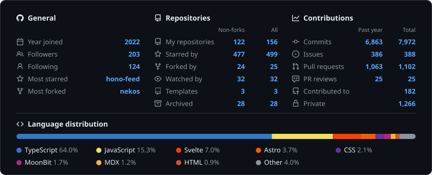

# Hi there 🐈

**English** | [日本語](README.ja.md)

-BC002D?logo=googletranslate\&logoColor=white)
-012169?logo=googletranslate\&logoColor=white)

<!--

-->

**I'm *otoneko.* a.k.a. *marron.***

***

I'm swimming in the ocean, forever and ever...

Portfolio: https://otoneko.cat / https://montblank.fun

Team: [@oto-home](https://github.com/oto-home) / Personal: [@oto-lab](https://github.com/oto-lab)

## Projects

Organizations I run for my main OSS projects.

- **[Purus](https://github.com/puruslang)**: A programming language you can write without the Shift key. It compiles to JavaScript ([purus.work](https://purus.work/))
- **[OpenMiQ](https://github.com/OpenMiQ)**: Make it a Quote bots for Discord and Misskey, a self-hostable API, and [makeitaquote](https://www.npmjs.com/package/makeitaquote), the library that draws the quote images
- **[Milkee](https://github.com/coffeescript-milkee)**: A build tool for CoffeeScript, configured with a single `coffee.config.cjs`, and its plugins ([milkee.org](https://milkee.org))
- **[Funmary](https://github.com/funmary-app)**: A web app for students at Future University Hakodate that puts class cancellations, make-up classes and room changes onto their own timetable ([funmary.app](https://funmary.app))
- **[Indentier](https://github.com/indentier)**: A silly formatter that hides `{`, `}`, `;` and trailing `,` in the right margin, so curly-brace languages look like Python or Ruby ([indentier.github.io](https://indentier.github.io/))

    

## Stats

## UUID

<code>a710c2c5-272c-495d-8215-d8444a007f95</code>

Given by @mimifuwacc ([Twitter](https://twitter.com/mimifuwacc) / [GitHub](https://github.com/mimifuwacc))

***

Issuer:

- <https://twitter.com/mimifuwacc/status/2037864351907107222> (@mimifuwacc)
- <https://twitter.com/rin_montblank/status/2097596799540432933> (@rin\_montblank)

## Recent activity

<!-- activity:start -->

- 🟣 [feat: add setValues for explicit env updates in v0.2.2](https://github.com/otnc/migenv/pull/23) - otnc/migenv
- 🟣 [fix: restore sidebar lyrics on recent Spotify versions](https://github.com/otnc/spotify-lyrics-position/pull/5) - otnc/spotify-lyrics-position
- 🟣 [feat: generate empty env values with fill and init](https://github.com/otnc/migenv/pull/22) - otnc/migenv
- 🟣 [feat: add template key migrations and prepare v0.2.1](https://github.com/otnc/migenv/pull/21) - otnc/migenv
- 🟣 [test(compat): cover \*.kiritanconfig loading on the oldest supported Node.js](https://github.com/otnc/kiritan/pull/79) - otnc/kiritan

<!-- activity:end -->

## Community

Tech topics & chat. I'm a staff of Evex Developers (left), and Oto Home is my own (right).

 

## Support me!

  

## Contact

- [Twitter: @rin\_pineapple](https://twitter.com/rin_pineapple)
- [Twitter: @rin\_montblank](https://twitter.com/rin_montblank)
- [Misskey: @o@misskey.otnc.dev](https://misskey.otnc.dev/@o)
- [Misskey: @m@misskey.otnc.dev](https://misskey.otnc.dev/@m)

More

<a href="https://commit-history.com/otnc">
  <picture>
    <source media="(prefers-color-scheme: dark)" srcset="https://commit-history.com/embed/otnc?theme=dark" />
    
  </picture>
</a>

